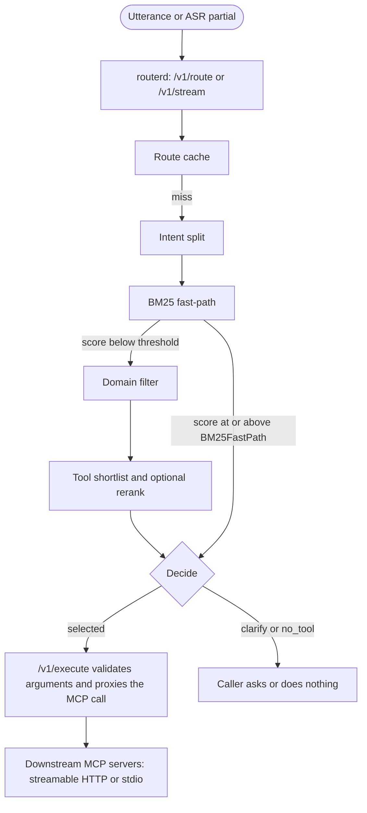

# MCP Dynamic Router

<div align="center">
  
</div>

<p align="center">
  <a href="https://github.com/kavinbm16/Mcp-Dynamic-Router/actions"></a>
  <a href="https://goreportcard.com/report/github.com/kavinbm16/Mcp-Dynamic-Router"></a>
  <a href="https://pkg.go.dev/github.com/kavinbm16/mcp-dynamic-router"></a>
  <a href="LICENSE"></a>
</p>

The router sits between an agent and many MCP servers. It keeps the full tool registry in its own index and, on each utterance, returns a short candidate list plus one of three decisions: `selected`, `clarify`, or `no_tool`. Agents and voice pipelines can use it as an HTTP sidecar (`routerd`) or as a Go library.

Putting every tool schema into the model prompt gets expensive and noisy as the registry grows. This project retrieves first, then exposes only the shortlist (`CandidateTopK`, default 5).

## Architecture



One `Route` call does the following:

1. **Cache lookup.** Identical utterance and context pairs reuse a recent result while `RouteCacheTTL` is positive (default 30s). `no_tool` results are not cached.
2. **Intent split.** Connectors such as "and also" or "then" fan out into parallel single-intent routes. The results are merged.
3. **BM25 fast-path.** If the best lexical score is at least `BM25FastPath` (default 8), the router returns that tool and skips embeddings and the reranker.
4. **Domain filter.** Tools are grouped by domain. Lexical scores, and embeddings when an `Embedder` is configured, pick the top `DomainTopK` domains (default 2), capped at `MaxDomainTools` (default 20).
5. **Tool shortlist.** Lexical and semantic scores are fused. An optional `Reranker` rescores that shortlist. The list is cut to `CandidateTopK`.
6. **Decision.** `selected` when confidence is at least `MinConfidence` (default 0.42) and the gap between the top two scores is at least `MinMargin` (default 0.06). `clarify` when the top two are too close. `no_tool` when confidence is below the threshold or the utterance is empty.

`RouteResult.Trace` is always filled in. It records registry version, selected domains, stage latencies, and whether embeddings or the reranker ran. That struct is separate from OpenTelemetry, which is off unless you enable it.

If the embedder or reranker errors on a query, routing continues on the scores it already has. Index build still fails if the embedder cannot embed the tool descriptions.

Stream RAG (`POST /v1/stream`) routes ASR partials through the same engine. A tool becomes `stable` after `StableUpdates` identical winners (default 2). Only tools marked `read_only` may be prefetched. Mutating tools are not called speculatively.

`routerd` watches `mcp.toml` and swaps server connections when the file parses. A broken edit does not drop the working set.

## Quickstart

The mock servers need no external MCP processes.

```bash
go run ./cmd/mock-servers
```

That listens on `:8091` (weather) and `:8092` (calculator) and writes `mcp-mock.toml`. In another terminal:

```bash
go run ./cmd/routerd -mcp mcp-mock.toml
```

`routerd` listens on `127.0.0.1:8090`. Route an utterance:

```bash
curl -s -X POST http://127.0.0.1:8090/v1/route \
  -H "Content-Type: application/json" \
  -d '{"utterance": "What is the weather in New York?", "final": true}'
```

The JSON body includes `decision`, `confidence`, `margin`, `candidates`, `reason`, and `trace`. Execute a selected tool by id. Arguments are checked against the tool schema before the call is proxied:

```bash
curl -s -X POST http://127.0.0.1:8090/v1/execute \
  -H "Content-Type: application/json" \
  -d '{"tool_id": "weather.forecast", "arguments": {"location": "New York"}}'
```

## Use it from Go

```go
package main

import (
    "context"
    "fmt"

    dynamicrouter "github.com/kavinbm16/mcp-dynamic-router"
    "github.com/kavinbm16/mcp-dynamic-router/router"
)

func main() {
    ctx := context.Background()
    app := dynamicrouter.NewBuilder().
        WithMCPConfigPath("mcp.toml").
        Build()
    defer app.Close()

    if _, err := app.Start(ctx); err != nil {
        panic(err)
    }

    result, err := app.Route(ctx, router.RouteRequest{
        Utterance: "What is the weather in Bengaluru?",
        Final:     true,
    })
    if err != nil {
        panic(err)
    }
    fmt.Printf("decision=%s confidence=%.3f margin=%.3f\n", result.Decision, result.Confidence, result.Margin)
    if len(result.Candidates) > 0 {
        fmt.Println(result.Candidates[0].Tool.ID)
    }
}
```

`NewBuilder` setters cover the routing thresholds (`WithMinConfidence`, `WithMinMargin`, `WithBM25FastPath`, `WithLexicalWeight`, `WithSemanticWeight`, `WithRerankerWeight`, `WithMaxDomainTools`), plus `WithEmbedder`, `WithReranker`, `WithEmbeddingCachePath`, and `WithTracing`.

## Configuration

`mcp.toml` lists downstream servers. HTTP and stdio transports are both supported:

```toml
[elicitation]
enabled = false
auto_accept = false
timeout = 30

[[servers]]
name = "weather-service"
transport = "streamable-http"
url = "http://127.0.0.1:8091/mcp"

[[servers]]
name = "local-fetch"
transport = "stdio"
command = "uvx"
args = ["mcp-server-fetch"]
```

Routing thresholds are Go config, not TOML. Defaults live in `router.DefaultConfig`.

| Field | Default | Role |
|---|---|---|
| `BM25FastPath` | 8 | Lexical score that skips embeddings and reranking. Negative disables the stage. |
| `DomainTopK` | 2 | Domains kept after stage 1. |
| `MaxDomainTools` | 20 | Tools allowed out of those domains before the final cut. |
| `CandidateTopK` | 5 | Candidates returned to the caller. |
| `LexicalWeight` / `SemanticWeight` | 0.45 / 0.55 | Fusion weights when embeddings ran. |
| `RerankerWeight` | 0.65 | Blend of the reranker score into the fused score. |
| `MinConfidence` | 0.42 | Below this, the decision is `no_tool`. |
| `MinMargin` | 0.06 | Below this gap, the decision is `clarify`. |
| `RouteCacheTTL` | 30s | How long a non-abstaining result is reused. |
| `TracingEnabled` | false | Emit OpenTelemetry spans. See below. |

## Routing accuracy eval

`testdata/cases.jsonl` and `testdata/cases.yaml` are the same labelled set: an utterance, optional context, the tool that should be rank 1, and the decision the lexical router should return. An empty `expected_tool` means the router should abstain (`no_tool`). The tools under test are `testdata/tools.json`.

```bash
go run ./cmd/router-eval -strict
go run ./cmd/router-eval -cases testdata/cases.yaml -verbose
go test ./eval
```

The command prints case counts, top-1, top-k (default 5), the false-route rate on abstention cases, nearest-rank p50 and p95 of `Trace.TotalLatency`, and one `FAIL` line per miss. `-strict` exits 1 when any case fails. `-min-top1` exits 1 when top-1 percent is below the given number. `-verbose` prints every case. JSONL, a JSON array, a `{"cases":[...]}` document, and YAML (a list or a `cases:` list) are all accepted.

`go test ./eval` loads both dataset files, checks they match, and fails on any miss. CI runs that test and `go run ./cmd/router-eval -strict`.

On this set, with `DefaultConfig` and no embedder, the harness reports top-1 of 100% and a false-route rate of 0% (9 cases: 7 tool, 2 abstention, 0 failures). Two weather paraphrases are labelled `clarify` on purpose: the expected tool is rank 1, and the margin is inside `MinMargin`, so the policy refuses to select. Latency percentiles are printed by the command; they move from run to run, so this README does not quote them.

Top-k can only count candidates the router returned. `DefaultConfig` keeps five.

## Tracing

Spans are off by default. `Route` results do not change when tracing is enabled. Nothing is exported until a `TracerProvider` is installed.

Enable it on the sidecar with either the flag or the environment variable:

```bash
go run ./cmd/routerd -tracing -mcp mcp.toml
MCP_ROUTER_TRACING=1 go run ./cmd/routerd -mcp mcp.toml
```

`MCP_ROUTER_TRACING` accepts `1`, `true`, `yes`, or `on`. In Go, `WithTracing(true)` or `Config.TracingEnabled` does the same thing. Library users who already have a global provider can set the flag and skip `telemetry.Setup`. `routerd` calls `telemetry.Setup` when tracing is on.

Exporter selection:

| Environment | Exporter |
|---|---|
| `OTEL_TRACES_EXPORTER=none` | Spans are created and dropped. |
| `OTEL_TRACES_EXPORTER=otlp`, or `OTEL_EXPORTER_OTLP_ENDPOINT` / `OTEL_EXPORTER_OTLP_TRACES_ENDPOINT` is set | OTLP/HTTP. |
| otherwise | JSON spans on stdout, so `-tracing` is visible without a collector. |

`OTEL_SERVICE_NAME` overrides the default service name `mcp-dynamic-router`. Incoming W3C `traceparent` headers are extracted on `/v1/route` and `/v1/stream` when tracing is on, and those HTTP spans parent the router spans.

A single route that misses the cache and the fast-path looks like this:

```text
routerd.route
  router.route
    router.cache_lookup
    router.bm25_fast_path
    router.domain_filter
      router.embed_query          # only when an embedder runs
    router.tool_select
      router.rerank               # only when a reranker is configured
    router.decide
```

Multi-intent utterances add `router.intent_split`, one `router.fragment` per clause, and `router.merge`. A cache hit records `router.cache_lookup` with `router.cache_hit=true` and does not re-run later stages.

The root span and the select and decide spans carry:

| Attribute | Meaning |
|---|---|
| `router.candidate_count` | Candidates returned to the caller. |
| `router.top_score` | `RouteResult.Confidence`. |
| `router.second_score` | Score of the second candidate, when one exists. |
| `router.margin` | Gap between the top two scores. With one candidate this is the stored margin (the top score from `decide`, or 1 on the BM25 fast-path). |
| `router.decision` | `selected`, `clarify`, or `no_tool`. |

The utterance text is not an attribute. `router.utterance_chars` is. Domain spans add `router.domain_count`, `router.selected_domains`, and `router.domain_tool_count` (the pool before the top-k cut).

## HTTP API

`routerd` binds `127.0.0.1:8090` unless `-listen` is set. Responses include CORS headers.

| Endpoint | Method | Purpose |
|---|---|---|
| `/healthz` | `GET` | Liveness. Returns registry version, tool count, and connected servers. |
| `/v1/route` | `POST` | Route one utterance. Body: `utterance`, optional `context`, `final`. |
| `/v1/stream` | `POST` | Stream RAG update. Body: `session_id`, `transcript`, optional `context`, `confidence`, `final`. |
| `/v1/execute` | `POST` | Validate arguments and call the tool. Body: `tool_id`, `arguments`. |
| `/v1/tools` | `GET` | Registry snapshot. |
| `/v1/servers` | `GET` | Connected server ids. |
| `/metrics` | `GET` | Prometheus text: request counters, decision counters, sessions, tools, servers. |

## Examples

Runnable integrations live in [`examples/`](examples):

- [Gemini Live (Python)](examples/gemini/gemini_live.py)
- [LiveKit Agents (Python)](examples/livekit/livekit_agent.py)
- [Pipecat (Python)](examples/pipecat/pipecat_router.py)
- [OpenAI Realtime (Python)](examples/openai_realtime/openai_realtime_session.py)
- [Gemini function calling (Go)](examples/gemini_go/main.go)
- [Custom embedder and reranker (Go)](examples/go_custom_llm/main.go)
- [HTTP gateway (Go)](examples/go_http_server/main.go)

## Tool descriptions

Routing quality follows the text in each tool description. Audit a registry locally or in CI:

```bash
go run ./cmd/router-audit -tools testdata/tools.json -minimum 90
```

A description the auditor accepts has `Domain`, `Purpose`, `Invoke when`, `Parameters`, `Limitations`, and `Example` sections, and each schema property has a type and a description.

## Docker

```bash
docker build -t mcp-dynamic-router .
docker run -d -p 8090:8090 \
  -v "$(pwd)/mcp.toml:/etc/routerd/mcp.toml:ro" \
  mcp-dynamic-router \
  -listen 0.0.0.0:8090 -mcp /etc/routerd/mcp.toml
```

`docker-compose.yml` publishes the same port and checks `/healthz`. Pass `-tracing` or `MCP_ROUTER_TRACING=1` in the service command when you want spans. Set `OTEL_EXPORTER_OTLP_ENDPOINT` when a collector is available; otherwise traces are written to the container stdout.

## Development

CI (`.github/workflows/ci.yml`) runs:

```bash
go build ./...
go vet ./...
go test -race ./...
go run ./cmd/router-audit
go run ./cmd/router-eval -strict
```

The lexical index benchmark is `go test -bench=. -benchmem ./router`.

## License

MIT. See [LICENSE](LICENSE).
