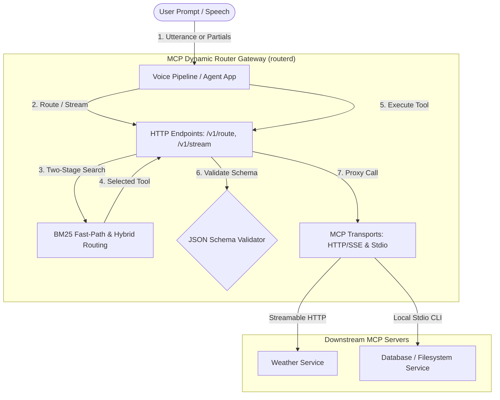

# MCP Dynamic Router

<div align="center">
  
</div>

<p align="center">
  <a href="https://github.com/kavinbm16/Mcp-Dynamic-Router/actions"></a>
  <a href="https://goreportcard.com/report/github.com/kavinbm16/Mcp-Dynamic-Router"></a>
  <a href="https://pkg.go.dev/github.com/kavinbm16/mcp-dynamic-router"></a>
  <a href="LICENSE"></a>
</p>

<h3 align="center">Give your LLM and voice pipelines access to hundreds of MCP tools — while exposing only the right 1–3 candidates on every turn.</h3>

---

## 💡 Why Dynamic Routing?

Hardcoding dozens of MCP servers into your agent or LLM client creates severe bottlenecks:

| Problem | Naive Setup (All Tools in LLM Context) | With MCP Dynamic Router |
|---|---|---|
| **Context Overhead** | 50–100+ tool schemas passed on every turn, burning tokens. | Only **1–3 candidate schemas** exposed per turn. |
| **Model Confusion** | High hallucination rate and misrouted tool calls. | Hybrid BM25 + Vector ranking isolates the exact tool. |
| **Voice Latency** | Waits for speech to finish before starting tool retrieval. | **Stream RAG** routes partial transcripts while user is speaking. |
| **Lifecycle** | Adding a tool requires restarting the LLM session. | **Zero-downtime hot-reload** via config watcher & MCP notifications. |
| **Safety** | LLM can invoke wrong tools on ambiguous input. | **Safe Abstention Policy** (`clarify` / `no_tool`). |



---

## ⚡ 60-Second Quickstart

Try the router locally with zero setup using the included mock servers.

### 1. Start the Mock Servers
```bash
go run ./cmd/mock-servers
```
*(Starts mock weather on `:8091` and mock calculator on `:8092`, generating `mcp-mock.toml`)*

### 2. Start the Dynamic Router Daemon
In a second terminal:
```bash
go run ./cmd/routerd -mcp mcp-mock.toml
```
*(Boots the sidecar gateway on `http://127.0.0.1:8090`)*

### 3. Route & Execute
In a third terminal, route a question:
```bash
curl -s -X POST http://localhost:8090/v1/route \
  -H "Content-Type: application/json" \
  -d '{"utterance": "What is the weather in New York?", "final": true}'
```
Response selects `weather.forecast` in `<1ms`:
```json
{
  "decision": "selected",
  "confidence": 1.0,
  "candidates": [
    { "tool": { "id": "weather.forecast", "name": "forecast" }, "score": 1.0, "rank": 1 }
  ]
}
```

Now execute the selected tool via the gateway (arguments are validated against the tool's schema):
```bash
curl -s -X POST http://localhost:8090/v1/execute \
  -H "Content-Type: application/json" \
  -d '{
    "tool_id": "weather.forecast",
    "arguments": { "location": "New York" }
  }'
```

---

## 🎯 Core Concepts

### 1. Two-Stage Routing Pipeline
To scale to thousands of tools without latency hits, routing occurs in two stages:
- **Fast-Path (<1ms)**: If lexical BM25 confidence exceeds `BM25FastPath` (default `8.0`), vector embeddings and LLM rerankers are bypassed entirely.
- **Stage 1 (Domain Filtering)**: Tools are grouped into domain clusters (`weather`, `calendar`, `database`). BM25 + embeddings pick the top domains, capping candidates to a maximum of 20 tools.
- **Stage 2 (Tool Shortlist & Fusion)**: Lexical and semantic scores are normalized and fused. An optional local LLM reranker can be applied.

### 2. Stream RAG (For Voice Pipelines)
Normal pipelines wait until the user stops speaking before starting tool selection. **Stream RAG** evaluates intermediate speech-to-text partials *while the user is still speaking*:

```text
"Could you check the weather in Bengaluru tom—"
                         │
                         ├── partial ASR update → domain retrieval → shortlist
                         │                                      └── warm safe connection
                         │
"...tomorrow morning?" ──┴── final commit → confirm route → bind args → execute
```
- **Hysteresis Stability**: Requires consecutive identical winner tools before marking route `stable`.
- **Read-Only Prefetching**: Safe tools marked `read_only: true` can be prefetched to warm downstream caches. Mutating actions are **never** executed speculatively.

### 3. Safe Abstention Policy
Wrong actions are worse than delayed actions. The router makes one of three decisions:
- **`selected`**: Top tool passed both confidence threshold (`MinConfidence: 0.42`) and safety margin (`MinMargin: 0.06`).
- **`clarify`**: Two or more plausible tools scored too close together to choose safely.
- **`no_tool`**: Input is general chit-chat or confidence is below threshold.

---

## 🛠️ How to Integrate

You can use the Dynamic Router in two ways:

### Option A: Run as a Sidecar (`routerd`)
Ideal for **Python, TypeScript, Node.js, LiveKit, Pipecat, OpenAI Realtime, and Gemini Live** agents.

Run the sidecar:
```bash
go run ./cmd/routerd -mcp mcp.toml
```

From any language, interact via simple HTTP JSON requests:
- `POST /v1/route` — Stateless routing for a single user turn.
- `POST /v1/stream` — Incremental streaming ASR updates with session tracking.
- `POST /v1/execute` — Execute the tool with schema validation.

### Option B: Embed Directly in Go
Import the package directly into your Go binary:

```go
package main

import (
    "context"
    "fmt"
    dynamicrouter "github.com/kavinbm16/mcp-dynamic-router"
    "github.com/kavinbm16/mcp-dynamic-router/router"
)

func main() {
    ctx := context.Background()
    
    // Fluent Builder initialization
    app := dynamicrouter.NewBuilder().
        WithMCPConfigPath("mcp.toml").
        Build()
    defer app.Close()

    if _, err := app.Start(ctx); err != nil {
        panic(err)
    }

    result, err := app.Route(ctx, router.RouteRequest{
        Utterance: "What is the weather in Bengaluru?",
        Final:     true,
    })
    if err != nil {
        panic(err)
    }

    fmt.Printf("Decision: %s, Tool: %s\n", result.Decision, result.Candidates[0].Tool.ID)
}
```

---

## ⚙️ Configuration (`mcp.toml`)

Configure both remote HTTP/SSE servers and local CLI tools (`stdio`):

```toml
[elicitation]
enabled = false
auto_accept = false
timeout = 30

# 1. Streamable HTTP / SSE MCP Server
[[servers]]
name = "weather-service"
transport = "streamable-http"
url = "http://localhost:8091/mcp"

# 2. Local CLI MCP Server (stdio sub-process)
[[servers]]
name = "local-fetch"
transport = "stdio"
command = "uvx"
args = ["mcp-server-fetch"]
```

> **Zero-Downtime Hot-Reload:** `routerd` watches `mcp.toml`. Modifying the file automatically updates server connections. If a syntax error is introduced, the reload is safely aborted and existing working sessions are preserved.

---

## 📡 HTTP API Reference

`routerd` listens on `127.0.0.1:8090` by default and includes CORS support.

| Endpoint | Method | Purpose | Key Parameters |
|---|---|---|---|
| `/healthz` | `GET` | Liveness & Readiness probe | Returns server count and tool count |
| `/v1/route` | `POST` | Route a single utterance | `{"utterance": "...", "context": "...", "final": true}` |
| `/v1/stream` | `POST` | Stream RAG partial updates | `{"session_id": "...", "transcript": "...", "confidence": 0.9, "final": false}` |
| `/v1/execute` | `POST` | Validate & execute tool | `{"tool_id": "...", "arguments": {...}}` |
| `/v1/tools` | `GET` | List all loaded tools | Returns full registry snapshot |
| `/v1/servers` | `GET` | List connected servers | Returns active server IDs |
| `/metrics` | `GET` | Prometheus metrics | Request counts, decision distributions, latencies |

---

## 📚 Integration Blueprints & Examples

Full, runnable integrations are available in the [`examples/`](examples) directory:

- **[Gemini Multimodal Live API (Python)](examples/gemini/gemini_live.py)** — Voice loop routing tool calls through the sidecar.
- **[LiveKit Agents (Python)](examples/livekit/livekit_agent.py)** — Streaming ASR partials and speech commit handling.
- **[Pipecat (Python)](examples/pipecat/pipecat_router.py)** — Real-time prefetching pipeline with Pipecat voice bots.
- **[OpenAI Realtime API (Python)](examples/openai_realtime/openai_realtime_session.py)** — WebSockets session intercepting tool intents.
- **[Google GenAI SDK (Go)](examples/gemini_go/main.go)** — Official Gemini function calling in Go.
- **[Custom Embedder & Reranker (Go)](examples/go_custom_llm/main.go)** — Hooking in custom OpenAI, Cohere, or HuggingFace models.
- **[Standalone Go HTTP Gateway (Go)](examples/go_http_server/main.go)** — Custom server wrapping the dynamic router library.

---

<details>
<summary><b>🔍 Advanced Features & Quality Standards (Click to Expand)</b></summary>

### 1. Zero-Allocation Inverted Index
BM25 retrieval uses an inverted posting index (`router/bm25.go`) with sub-2µs scoring and 99% allocation reduction, delivering consistent `<10µs` end-to-end lexical routing.

### 2. Persistent Embedding Cache
Configure `WithEmbeddingCachePath("cache/embeddings.json")` to persist vector embeddings to disk across daemon restarts, eliminating duplicate embedding calls.

### 3. Fail-Open Outage Resilience
If your remote embedding or reranking service (Ollama / Cloud LLM) fails or times out, the router automatically degrades to pure BM25 lexical routing without returning 500 errors.

### 4. Tool Description Auditing (`router-audit`)
High-precision routing requires descriptive tool definitions. Audit descriptions locally or in CI:
```bash
go run ./cmd/router-audit -tools testdata/tools.json -minimum 90
```
Recommended format for tool descriptions:
```text
Domain: calendar
Purpose: Create a new event in the user's calendar.
Invoke when: Call this tool when the user asks to schedule or add an event.
Parameters: title (string), start_time (ISO-8601).
Limitations: Does not search or delete existing events.
Example: User: "Schedule lunch tomorrow at noon."
```

### 5. Accuracy & Latency Benchmark (`router-eval`)
Evaluate top-1/top-5 accuracy and routing latency against labeled cases:
```bash
go run ./cmd/router-eval -tools testdata/tools.json -cases testdata/cases.jsonl
```
</details>

---

## 🐳 Docker Deployment

Run the sidecar with Docker:

```bash
docker build -t mcp-dynamic-router .
docker run -d -p 8090:8090 \
  -v $(pwd)/mcp.toml:/etc/routerd/mcp.toml:ro \
  mcp-dynamic-router \
  -listen 0.0.0.0:8090 -mcp /etc/routerd/mcp.toml
```

Or with `docker-compose.yml`:
```yaml
services:
  routerd:
    build: .
    ports:
      - "8090:8090"
    volumes:
      - ./mcp.toml:/etc/routerd/mcp.toml:ro
    healthcheck:
      test: ["CMD-SHELL", "wget -q --spider http://127.0.0.1:8090/healthz || exit 1"]
    restart: unless-stopped
```

---

## 🧪 Testing & Verification

```bash
# Run all tests with race detector
go test -race -v ./...

# Static analysis
go vet ./...

# Benchmark BM25 inverted index
go test -bench=. -benchmem ./router
```

---

## 📄 License

MIT. See [LICENSE](LICENSE).
